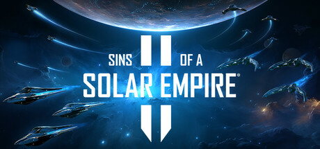

**Sins of a Solar Empire II is the long-awaited sequel with modernized graphics, new cultures system, and expanded diplomatic options across even larger star systems. Continues the franchise's unique real-time 4X approach to space grand strategy.**

---

## 📖 About

Sins of a Solar Empire II is the long-awaited sequel with modernized graphics, new cultures system, and expanded diplomatic options across even larger star systems. Continues the franchise's unique real-time 4X approach to space grand strategy.

## ⚠️ Problems Without Trainer

| Problem | Status |
|---------|--------|
| **Learning Curve** — New culture and influence systems add significant complexity for returning players | ✅ Solved |
| **Tech Research Prioritization** — Three tech trees require careful sequencing for economic efficiency | ✅ Solved |
| **Large Battle Performance** — Massive fleet engagements can strain even high-end hardware | ✅ Solved |
| **Early Game Pacing** — First hours of expansion and colonization feel slow before momentum builds | ✅ Solved |

## ✅ Solution

The **Sins of a Solar Empire II Trainer** solves all these issues by giving you complete control over the game.

## 🎯 Full Feature List

- Unlimited Resources
- God Mode / Invincibility
- Instant Skill Cooldown
- One-Hit Kill
- Freeze Game Timer
- Unlock All Items & Achievements
- Custom Speed Multiplier
- Save State Anywhere

## 🚀 Quick Start

1. **Disable Windows Defender** temporarily (trainer may trigger false positive)
2. Download the trainer from the button above
3. Launch Sins of a Solar Empire II
4. Run the trainer as Administrator
5. Activate desired cheats with hotkeys

## 💎 Free vs Paid

| Feature | Free | Pro |
|---------|------|-----|
| Basic God Mode | ✅ | ✅ |
| Unlimited Resources | ✅ | ✅ |
| All Advanced Cheats | ❌ | ✅ |
| Auto-Updates | ❌ | ✅ |
| Priority Support | ❌ | ✅ |

## 💻 Requirements

- Windows 10/11 (64-bit)
- Sins of a Solar Empire II (any version)
- .NET Framework 4.8+
- DirectX 11+

## 🍎 macOS

macOS users can use our alternative tool:

## ⚖️ Legal

This trainer is for educational and single-player use only. Use responsibly.

---

